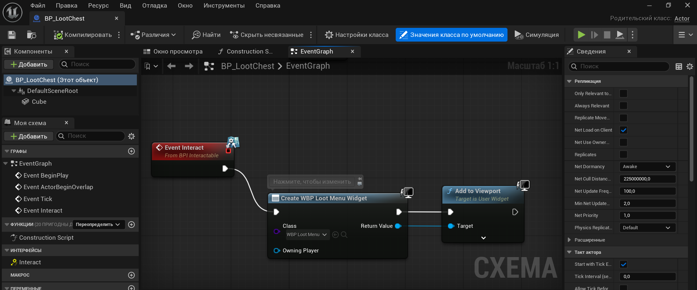
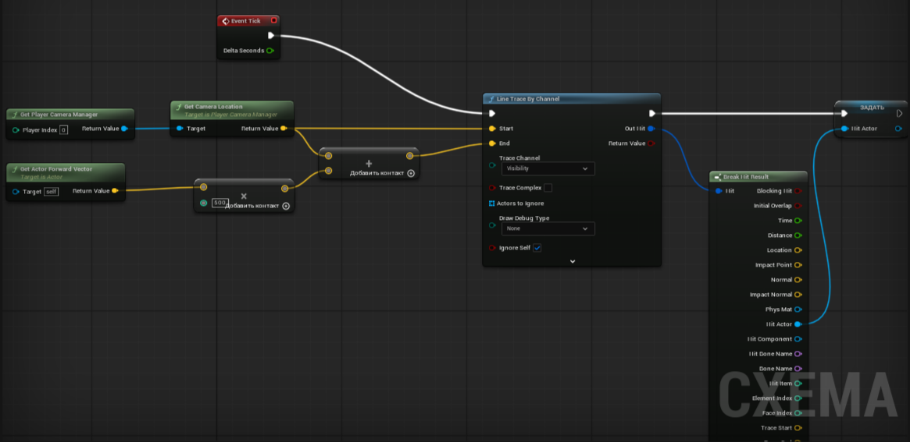
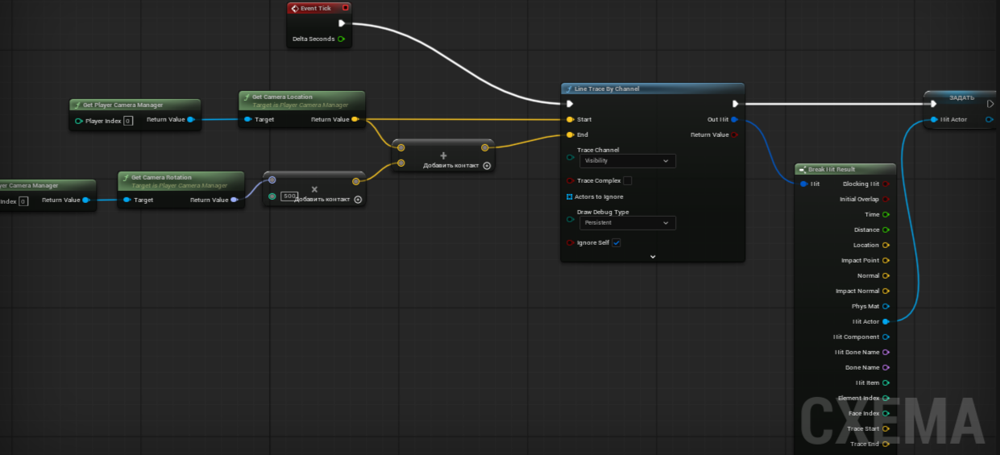
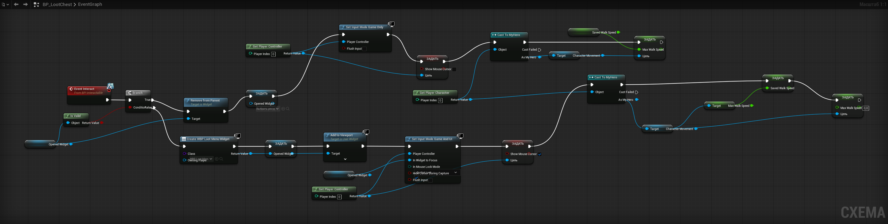

# 🎮 RunAndSurvive — Настройка проекта Unreal Engine 5.7

## 🎯 Меню

1. [Создать проект на Unreal Engine 5.7 с персонажем, управляемым с клавиатуры и мыши](#Создать-проект-на-Unreal-Engine-5.7-с-персонажем,-управляемым-с-клавиатуры-и-мыши)
2. [Настройка прыжка персонажа по нажатию клавиши](#Настройка-прыжка-персонажа-по-нажатию-клавиши)
3. [Приседание персонажа на ctrl](#Приседание-персонажа-на-ctrl)
4. [Плавное приседание персонажа](#Плавное-приседание-персонажа)
5. [Спринт персонажа](#Спринт-персонажа)
6. [Структура C++ файлов и параметры персонажа в отдельном файле](#Структура-C-файлов-и-параметры-персонажа-в-отдельном-файле)
7. [Создание HUD](#Создание-HUD)
8. [Сундук с инвентарём в Unreal Engine](#Сундук-с-инвентарём-в-Unreal-Engine)
9. [Исправление направления луча (Line Trace)](#-исправление-направления-луча-line-trace)
10. [Закрытие меню сундука (Toggle)](#-закрытие-меню-сундука-toggle)
11. [Вопросы](#Вопросы)

---

# Создать проект на Unreal Engine 5.7 с персонажем, управляемым с клавиатуры и мыши
## 🔹 ЭТАП 1: УСТАНОВКА РАСШИРЕНИЙ VS CODE (ДЕЛАЕТСЯ ОДИН РАЗ)

1. Открой **VS Code**.
2. Нажми `Ctrl+Shift+X` (панель расширений).
3. Установи **три** расширения:
   - `C/C++ Extension Pack`
   - `C# Dev Kit`
   - `UE5 Development Tools`
4. Перезапусти VS Code.

---

## 🔹 ЭТАП 2: СОЗДАНИЕ ПРОЕКТА

1. Открой **Epic Games Launcher** → запусти **Unreal Engine 5.7**.
2. В окне **Project Browser**:
   - Выбери **Игры (Games)** → **Пустой (Blank)**.
   - **Обязательно** выбери **C++** (не Blueprint!).
   - Назови проект: `RunAndSurvive`.
   - Укажи папку: `/---своя папка---/`
   - Нажми **"Создать"**.
3. **Важно:** Не открывай VS Code вручную. Проект создастся сам.

---

## 🔹 ЭТАП 3: ПЕРВЫЙ ЗАПУСК ПРОЕКТА (ПРОВЕРКА)

1. Найди файл `RunAndSurvive.uproject` в папке:
/---своя папка ---/ \RunAndSurvive\

2. **Дважды кликни** по нему.
3. Unreal Editor должен открыться без ошибок.
4. **Закрой** Unreal Editor.

---

## 🔹 ЭТАП 4: СОЗДАНИЕ C++ КЛАССА ПЕРСОНАЖА

1. В Unreal Editor: **Инструменты → Программирование → Новый класс C++...**.
2. Выбери родительский класс **Character**.
3. Назови класс: `MyHero`.
4. Нажми **"Создать"**.
5. **Важно:** VS Code откроется автоматически. Не закрывай его, пока не напишешь код.

---

## 🔹 ЭТАП 5: НАПИСАНИЕ КОДА (СКОПИРУЙ И ВСТАВЬ)

### В файле `MyHero.h`

Найди строку `GENERATED_BODY()` и **после неё** добавь:

```cpp
public:
 void MoveForward(float Value);
 void MoveRight(float Value);
```

 В файле `MyHero.cpp`
 1. Найди функцию SetupPlayerInputComponent и замени её на:
```cpp
void AMyHero::SetupPlayerInputComponent(UInputComponent* PlayerInputComponent)
{
    Super::SetupPlayerInputComponent(PlayerInputComponent);

    PlayerInputComponent->BindAxis("MoveForward", this, &AMyHero::MoveForward);
    PlayerInputComponent->BindAxis("MoveRight", this, &AMyHero::MoveRight);
    PlayerInputComponent->BindAxis("Turn", this, &AMyHero::AddControllerYawInput);
    PlayerInputComponent->BindAxis("LookUp", this, &AMyHero::AddControllerPitchInput);

    // Для прыжка (добавь эти две строки, если хочешь)
    PlayerInputComponent->BindAction("Jump", IE_Pressed, this, &AMyHero::Jump);
    PlayerInputComponent->BindAction("Jump", IE_Released, this, &AMyHero::StopJumping);
}
```

В самый конец файла (после последней }) добавь:
```cpp
void AMyHero::MoveForward(float Value)
{
    if (Controller && Value != 0.0f)
    {
        FRotator YawRotation(0, Controller->GetControlRotation().Yaw, 0);
        FVector Direction = FRotationMatrix(YawRotation).GetUnitAxis(EAxis::X);
        AddMovementInput(Direction, Value);
    }
}

void AMyHero::MoveRight(float Value)
{
    if (Controller && Value != 0.0f)
    {
        FRotator YawRotation(0, Controller->GetControlRotation().Yaw, 0);
        FVector Direction = FRotationMatrix(YawRotation).GetUnitAxis(EAxis::Y);
        AddMovementInput(Direction, Value);
    }
}
```

3. Сохрани файлы (Ctrl+S).

4. Закрой VS Code.

🔹 ЭТАП 7: КОМПИЛЯЦИЯ (САМЫЙ ВАЖНЫЙ ШАГ)
1. Закрой Unreal Editor.

2. Найди файл RunAndSurvive.uproject.

3. Дважды кликни по нему.

4. Если появится окно "The following modules are missing..." — нажми "Да".

5. Дождись компиляции (внизу будет прогресс-бар).

6. Unreal Editor откроется.

7. Проверь: В Контент браузере → Классы C++ → RunAndSurvive должен появиться MyHero.

8. !!!ВАЖНО!!! Если там нет файла после перезапуска Unreal Engine, то нужно зайти в папку где лежит ваш проект и удалить папки:
    * Binaries/

    * Intermediate/

    * Saved/

И пересобрать проект, проверить ещё раз, есть ли в Контент браузере → Классы C++ -> MyHero. Если нет, значит может быть ошибка в коде.

## 🔹 ЭТАП 6: НАСТРОЙКА ВВОДА (КЛАВИШИ)

1. Открой проект через `.uproject`.
2. В Unreal Editor: **Правка → Настройки проекта → Движок → Ввод**.
3. В разделе **"Назначения осей" (Axis Mappings)** нажми **"Добавить"** для каждой строки:

| Имя оси | Клавиша | Масштаб (Scale) |
|---------|---------|-----------------|
| MoveForward | W | 1.0 |
| MoveForward | S | -1.0 |
| MoveRight | D | 1.0 |
| MoveRight | A | -1.0 |
| Turn | Mouse X | 1.0 |
| LookUp | Mouse Y | -1.0 |

4. В разделе **"Назначения действий" (Action Mappings)** нажми **"Добавить"**:

| Имя действия | Клавиша |
|--------------|---------|
| Jump | Space Bar |

5. Закрой настройки.

---   

## 🔹 ЭТАП 7: СОЗДАНИЕ BLUEPRINT ПЕРСОНАЖА
1. В Контент браузере открой папку "Классы C++" → "RunAndSurvive".

2. Найди MyHero → нажми правой кнопкой → "Создать Blueprint класс на основе MyHero".

3. Назови: BP_MyHero.

## 🔹 ЭТАП 8: НАСТРОЙКА КАМЕРЫ В BLUEPRINT
1. Дважды кликни по BP_MyHero.

2. В левой панели "Компоненты" нажми "Добавить компонент" → добавь SpringArmComponent.

3. Снова "Добавить компонент" → добавь CameraComponent.

4. В "Подробностях" для SpringArm:

    * Длина → 400

    * Use Pawn Control Rotation → ✅ (галочка)

5. В "Подробностях" для Camera:

    * Use Pawn Control Rotation → ❌ (сними галочку)

6. Нажми "Скомпилировать" → "Сохранить".

## 🔹 ЭТАП 9: СОЗДАНИЕ GAMEMODE

1. В Контент браузере нажми правой кнопкой → "Создать Blueprint класс".

2. Выбери GameModeBase → назови BP_GameMode.

3. Дважды кликни по BP_GameMode.

4. В "Подробностях" найди "Default Pawn Class" → выбери BP_MyHero.

5. Нажми "Скомпилировать" → "Сохранить".

## 🔹 ЭТАП 10: НАЗНАЧЕНИЕ GAMEMODE
1. Правка → Настройки проекта → Карты и режимы.

2. В поле "Режим игры по умолчанию" выбери BP_GameMode.

## 🔹 ЭТАП 11: ДОБАВЛЕНИЕ ТОЧКИ СТАРТА
1. На сцене (в 3D-виде) посмотри, есть ли PlayerStart.

2. Если нет — найди в Контент браузере → "Движок" → "Базовые" → PlayerStart.

3. Перетащи его на сцену.

4. Поставь координаты Z = 100 (над землёй).

## 🔹 ЭТАП 12: ТЕСТ
1. Нажми "Играть" (зелёный треугольник).

2. Проверь:

    * WASD — движение.

    * Мышь — поворот камеры.

    * Пробел — прыжок.

# Настройка прыжка персонажа по нажатию клавиши.

---

## 🔹 ЭТАП 1: НАСТРОЙКА ВВОДА

1. Открой **Unreal Editor**.
2. Перейди: **Правка → Настройки проекта → Движок → Ввод**.
3. В разделе **"Назначения действий" (Action Mappings)** нажми **"Добавить"**.
4. Заполни:
   - **Имя действия:** `Jump`
   - **Клавиша:** `Space Bar` (Пробел)
   - **Модификаторы:** оставь пустыми
5. Закрой настройки.

> ⚠️ Имя `Jump` должно быть написано **точно** так — с большой буквы, без пробелов.

---

## 🔹 ЭТАП 2: НАПИСАНИЕ КОДА

### Файл `MyHero.cpp` — функция `SetupPlayerInputComponent`

Найди эту функцию и добавь **две строки** для прыжка:

```cpp
void AMyHero::SetupPlayerInputComponent(UInputComponent* PlayerInputComponent)
{
    Super::SetupPlayerInputComponent(PlayerInputComponent);

    // Движение
    PlayerInputComponent->BindAxis("MoveForward", this, &AMyHero::MoveForward);
    PlayerInputComponent->BindAxis("MoveRight", this, &AMyHero::MoveRight);
    PlayerInputComponent->BindAxis("Turn", this, &AMyHero::AddControllerYawInput);
    PlayerInputComponent->BindAxis("LookUp", this, &AMyHero::AddControllerPitchInput);

    // 👇 ЭТИ ДВЕ СТРОКИ ОТВЕЧАЮТ ЗА ПРЫЖОК
    PlayerInputComponent->BindAction("Jump", IE_Pressed, this, &AMyHero::Jump);
    PlayerInputComponent->BindAction("Jump", IE_Released, this, &AMyHero::StopJumping);
}
```

**Что делают эти строки:**

| Строка | Когда срабатывает | Что вызывает |
|--------|-------------------|--------------|
| `BindAction("Jump", IE_Pressed, ...)` | При **нажатии** Пробела | `Jump()` — персонаж прыгает |
| `BindAction("Jump", IE_Released, ...)` | При **отпускании** Пробела | `StopJumping()` — персонаж перестаёт прыгать |

> ⚠️ Функции `Jump()` и `StopJumping()` **уже встроены** в класс `ACharacter`. Писать их самому не нужно!

---

## 🔹 ЭТАП 3: КОМПИЛЯЦИЯ (ОБЯЗАТЕЛЬНО!)

После изменения кода **обязательно** пересобери проект:

1. Сохрани файл (`Ctrl+S`).
2. Закрой **VS Code**.
3. Закрой **Unreal Editor**.
4. Удали папки в корне проекта:
   - `Binaries/`
   - `Intermediate/`
   - `Saved/`
5. Найди файл `RunAndSurvive.uproject` и **дважды кликни** по нему.
6. Если появится окно **"The following modules are missing..."** — нажми **"Да"**.
7. Дождись компиляции.

---

## 🔹 ЭТАП 4: НАСТРОЙКА СИЛЫ ПРЫЖКА (если нужно)

Если персонаж прыгает **слишком слабо** или **слишком высоко**:

1. Открой **BP_MyHero** (дважды кликни).
2. В левой панели **"Компоненты"** выбери **CharacterMovement**.
3. В правой панели **"Подробности"** найди раздел **"Character Movement: Jumping / Falling"**.
4. Настрой параметры:

| Параметр | Значение по умолчанию | Что делает |
|----------|----------------------|------------|
| **Jump Z Velocity** | 600 | Сила прыжка (чем больше — тем выше) |
| **Air Control** | 0.2 | Управление в воздухе (0 = нет, 1 = полное) |
| **Gravity Scale** | 1.0 | Гравитация (чем больше — тем быстрее падает) |

5. **Скомпилируй** → **Сохрани**.

---

## 🔹 ЭТАП 5: ТЕСТ

1. Нажми **"Играть"** (зелёный треугольник).
2. Нажми **Пробел** — персонаж должен подпрыгнуть.

---

## ✅ ИТОГ

После выполнения всех этапов:
- ✅ Персонаж **прыгает** по нажатию Пробела.
- ✅ Прыжок можно **настроить** через CharacterMovement.
- ✅ Код **скомпилирован** и работает.

---

## 📌 ПОЛЕЗНЫЕ СОВЕТЫ

1. **Всегда** удаляй `Binaries/`, `Intermediate/`, `Saved/` после серьёзных изменений в коде — это решает 90% проблем.
2. **Проверяй** настройки ввода в **Настройки проекта → Движок → Ввод**.
3. **Сохраняй** файлы перед компиляцией (`Ctrl+S`).

---

# Приседание персонажа на ctrl

## 🎯 Цель
Настроить приседание персонажа по нажатию клавиши **Left Ctrl**.

---

## 🔹 ЭТАП 1: НАСТРОЙКА ВВОДА

1. Открой **Unreal Editor**.
2. Перейди: **Правка → Настройки проекта → Движок → Ввод**.
3. В разделе **"Назначения действий" (Action Mappings)** нажми **"Добавить"**.
4. Создай **два** действия:

| Имя действия | Клавиша |
|--------------|---------|
| **Crouch** | `Left Ctrl` (Левый Ctrl) |
| **UnCrouch** | `Left Ctrl` (Левый Ctrl) |

> ⚠️ Имена `Crouch` и `UnCrouch` должны быть написаны **точно** так — с большой буквы, без пробелов.

**Зачем два действия на одну клавишу:**
- `Crouch` — срабатывает при **нажатии** (персонаж приседает).
- `UnCrouch` — срабатывает при **отпускании** (персонаж встаёт).

5. Закрой настройки.

---

## 🔹 ЭТАП 2: ДОБАВЛЕНИЕ ФУНКЦИЙ В ЗАГОЛОВОЧНЫЙ ФАЙЛ

### Файл `MyHero.h`

После `GENERATED_BODY()` добавь объявления двух новых функций:

```cpp
public:
    void MoveForward(float Value);
    void MoveRight(float Value);

    // 👇 ДЛЯ ПРИСЕДАНИЯ
    void StartCrouch();
    void StopCrouch();
```

> ⚠️ **Важно:** Функции `Crouch()` и `UnCrouch()` в классе `ACharacter` **требуют параметр `bool`**, а `BindAction` не может его передать. Поэтому мы создаём **свои функции-обёртки** без параметров.

---

## 🔹 ЭТАП 3: НАПИСАНИЕ КОДА

### Файл `MyHero.cpp`

**1. В функции `SetupPlayerInputComponent`** добавь две строки для приседания:

```cpp
void AMyHero::SetupPlayerInputComponent(UInputComponent* PlayerInputComponent)
{
    Super::SetupPlayerInputComponent(PlayerInputComponent);

    // Движение
    PlayerInputComponent->BindAxis("MoveForward", this, &AMyHero::MoveForward);
    PlayerInputComponent->BindAxis("MoveRight", this, &AMyHero::MoveRight);
    PlayerInputComponent->BindAxis("Turn", this, &AMyHero::AddControllerYawInput);
    PlayerInputComponent->BindAxis("LookUp", this, &AMyHero::AddControllerPitchInput);

    // Прыжок
    PlayerInputComponent->BindAction("Jump", IE_Pressed, this, &AMyHero::Jump);
    PlayerInputComponent->BindAction("Jump", IE_Released, this, &AMyHero::StopJumping);

    // 👇 ПРИСЕДАНИЕ
    PlayerInputComponent->BindAction("Crouch", IE_Pressed, this, &AMyHero::StartCrouch);
    PlayerInputComponent->BindAction("UnCrouch", IE_Released, this, &AMyHero::StopCrouch);
}
```

**2. В конец файла** добавь реализации новых функций:

```cpp
void AMyHero::StartCrouch()
{
    Crouch();
}

void AMyHero::StopCrouch()
{
    UnCrouch();
}
```

**Что делают эти функции:**

| Функция | Что вызывает | Когда срабатывает |
|---------|--------------|-------------------|
| `StartCrouch()` | `Crouch()` — встроенная функция `ACharacter` | При **нажатии** Left Ctrl |
| `StopCrouch()` | `UnCrouch()` — встроенная функция `ACharacter` | При **отпускании** Left Ctrl |

> ⚠️ Функции `Crouch()` и `UnCrouch()` **уже встроены** в класс `ACharacter`. Писать их самому не нужно — мы просто вызываем их из своих функций-обёрток.

---

## 🔹 ЭТАП 4: ВКЛЮЧЕНИЕ ПРИСЕДАНИЯ В CHARACTER MOVEMENT

По умолчанию приседание может быть отключено. Проверь:

1. Открой **BP_MyHero** (дважды кликни).
2. В левой панели **"Компоненты"** выбери **CharacterMovement**.
3. В правой панели **"Подробности"** найди раздел **"Character Movement (General Settings)"**.
4. Убедись, что **"Can Crouch"** = **✅ (галочка стоит)**.
5. Если нет — поставь галочку.

### Настройка высоты и скорости приседания

В том же разделе **CharacterMovement** найди **"Character Movement: Crouching"**:

| Параметр | Значение по умолчанию | Что делает |
|----------|----------------------|------------|
| **Crouched Half Height** | 40 | Высота персонажа в приседе (чем меньше — тем ниже) |
| **Can Crouch** | ✅ | Разрешает приседание |
| **Max Walk Speed Crouched** | 300 | Скорость передвижения в приседе |

**Рекомендуемые значения:**
- **Crouched Half Height** → `40` (стандарт)
- **Max Walk Speed Crouched** → `300` (медленнее, чем обычная ходьба)

6. **Скомпилируй** → **Сохрани**.

---

## 🔹 ЭТАП 5: КОМПИЛЯЦИЯ (ОБЯЗАТЕЛЬНО!)

После изменения кода **обязательно** пересобери проект:

1. Сохрани файл (`Ctrl+S`).
2. Закрой **VS Code**.
3. Закрой **Unreal Editor**.
4. Удали папки в корне проекта:
   - `Binaries/`
   - `Intermediate/`
   - `Saved/`
5. Найди файл `RunAndSurvive.uproject` и **дважды кликни** по нему.
6. Если появится окно **"The following modules are missing..."** — нажми **"Да"**.
7. Дождись компиляции.

---

## 🔹 ЭТАП 6: ТЕСТ

1. Нажми **"Играть"** (зелёный треугольник).
2. Нажми **Left Ctrl** — персонаж должен присесть.
3. Отпусти **Left Ctrl** — персонаж должен встать.
4. Попробуй **двигаться в приседе** — скорость должна быть ниже.

---

## ⚠️ ЧАСТЫЕ ОШИБКИ

| Ошибка | Причина | Решение |
|--------|---------|---------|
| `error C2665: BindAction: ни одна перегруженная функция...` | `Crouch()` требует параметр `bool` | Используй функции-обёртки `StartCrouch()` и `StopCrouch()` (Этап 2-3) |
| Приседание не работает | Забыл строки `BindAction` в коде | Добавь обе строки (Этап 3) |
| Приседание не работает | Имя действия не `Crouch` / `UnCrouch` | Проверь настройки ввода (Этап 1) |
| Приседание не работает | `Can Crouch` выключен | Включи в CharacterMovement (Этап 4) |
| Персонаж не встаёт | Не привязан `UnCrouch` | Добавь строку `BindAction("UnCrouch", IE_Released, ...)` |
| Персонаж проваливается под пол | `Crouched Half Height` слишком маленький | Увеличь до 40-50 |

---

## ✅ ИТОГ

После выполнения всех этапов:
- ✅ Персонаж **приседает** по нажатию **Left Ctrl**.
- ✅ Персонаж **встаёт** при отпускании **Left Ctrl**.
- ✅ Скорость в приседе **ниже**, чем при обычной ходьбе.
- ✅ Приседание можно **настроить** через CharacterMovement.

---

# Плавное приседание персонажа

## 🎯 Цель
Настроить **плавное** (а не мгновенное) приседание персонажа по нажатию **Left Ctrl**, с изменением высоты капсулы и скорости передвижения.

---

## 🧠 Как это работает

| Обычное приседание (`Crouch()`) | Плавное приседание (наш способ) |
|--------------------------------|---------------------------------|
| Высота меняется **мгновенно** | Высота меняется **плавно** через `FMath::FInterpTo` |
| Камера «прыгает» | Камера плавно опускается |
| Скорость меняется мгновенно | Скорость меняется в `StartCrouch` / `StopCrouch` |

**Механика:**
1. При нажатии Left Ctrl мы задаём **цель** (`TargetCapsuleHalfHeight`).
2. Каждый кадр в `Tick()` высота капсулы **плавно интерполируется** к цели.
3. `FMath::FInterpTo` делает движение плавным и независимым от FPS.

---

## 🔹 ЭТАП 1: НАСТРОЙКА ВВОДА

1. Открой **Unreal Editor**.
2. Перейди: **Правка → Настройки проекта → Движок → Ввод**.
3. В разделе **"Назначения действий" (Action Mappings)** нажми **"Добавить"**.
4. Создай **два** действия:

| Имя действия | Клавиша |
|--------------|---------|
| **Crouch** | `Left Ctrl` |
| **UnCrouch** | `Left Ctrl` |

> ⚠️ Имена должны быть написаны **точно** так — с большой буквы, без пробелов.

**Зачем два действия на одну клавишу:**
- `Crouch` — срабатывает при **нажатии** → персонаж приседает.
- `UnCrouch` — срабатывает при **отпускании** → персонаж встаёт.

5. Закрой настройки.

---

## 🔹 ЭТАП 2: ДОБАВЛЕНИЕ ПЕРЕМЕННЫХ И ФУНКЦИЙ В `MyHero.h`

Открой `MyHero.h` и добавь:

```cpp
#pragma once

#include "CoreMinimal.h"
#include "GameFramework/Character.h"
#include "MyHero.generated.h"

UCLASS()
class RUNANDSURVIVE_API AMyHero : public ACharacter
{
    GENERATED_BODY()

public:
    AMyHero();

protected:
    virtual void BeginPlay() override;

public:
    virtual void Tick(float DeltaTime) override;
    virtual void SetupPlayerInputComponent(class UInputComponent* PlayerInputComponent) override;

    void MoveForward(float Value);
    void MoveRight(float Value);

    // 👇 ДЛЯ ПРИСЕДАНИЯ
    void StartCrouch();
    void StopCrouch();

private:
    // 👇 ПЕРЕМЕННЫЕ ДЛЯ ПЛАВНОГО ПРИСЕДАНИЯ
    float StandingCapsuleHalfHeight;   // Высота стоя
    float CrouchingCapsuleHalfHeight;  // Высота в приседе
    float TargetCapsuleHalfHeight;     // Куда стремимся
};
```

**Зачем нужны переменные:**

| Переменная | Что хранит |
|------------|-----------|
| `StandingCapsuleHalfHeight` | Высоту капсулы **стоя** (запоминается в `BeginPlay`) |
| `CrouchingCapsuleHalfHeight` | Высоту капсулы **в приседе** (вычисляется как половина от стоя) |
| `TargetCapsuleHalfHeight` | **Цель** — куда интерполируем каждый кадр |

---

## 🔹 ЭТАП 3: НАПИСАНИЕ КОДА В `MyHero.cpp`

### ⚠️ КРИТИЧЕСКИ ВАЖНО: Два инклуда!

В **самый верх** файла `MyHero.cpp` добавь **два** `#include`:

```cpp
#include "MyHero.h"
#include "Components/CapsuleComponent.h"                 // 👈 для UCapsuleComponent
#include "GameFramework/CharacterMovementComponent.h"    // 👈 для UCharacterMovementComponent
```

> ⚠️ **Без этих инклудов компиляция упадёт** с ошибкой `error C2027: использование неопределенного типа "UCapsuleComponent"`.

---

### Добавляем/изменяем код `MyHero.cpp`

```cpp
// Fill out your copyright notice in the Description page of Project Settings.
#include "Components/CapsuleComponent.h"
#include "GameFramework/CharacterMovementComponent.h"

void AMyHero::BeginPlay()
{
    Super::BeginPlay();

    // Запоминаем стандартную высоту капсулы (стоя)
    StandingCapsuleHalfHeight = GetCapsuleComponent()->GetUnscaledCapsuleHalfHeight();

    // Высота в приседе — половина от высоты стоя
    CrouchingCapsuleHalfHeight = StandingCapsuleHalfHeight * 0.5f;

    // Изначально мы стоим
    TargetCapsuleHalfHeight = StandingCapsuleHalfHeight;
}

void AMyHero::Tick(float DeltaTime)
{
    Super::Tick(DeltaTime);

    // Текущая высота капсулы
    float CurrentHalfHeight = GetCapsuleComponent()->GetUnscaledCapsuleHalfHeight();

    // Плавно интерполируем к целевой высоте
    // 8.0f — скорость интерполяции (чем больше, тем быстрее приседает)
    float NewHalfHeight = FMath::FInterpTo(CurrentHalfHeight, TargetCapsuleHalfHeight, DeltaTime, 8.0f);

    // Применяем новую высоту
    GetCapsuleComponent()->SetCapsuleHalfHeight(NewHalfHeight);
}

void AMyHero::SetupPlayerInputComponent(UInputComponent* PlayerInputComponent)
{
    Super::SetupPlayerInputComponent(PlayerInputComponent);

    PlayerInputComponent->BindAxis("MoveForward", this, &AMyHero::MoveForward);
    PlayerInputComponent->BindAxis("MoveRight", this, &AMyHero::MoveRight);
    PlayerInputComponent->BindAxis("Turn", this, &AMyHero::AddControllerYawInput);
    PlayerInputComponent->BindAxis("LookUp", this, &AMyHero::AddControllerPitchInput);

    // Прыжок
    PlayerInputComponent->BindAction("Jump", IE_Pressed, this, &AMyHero::Jump);
    PlayerInputComponent->BindAction("Jump", IE_Released, this, &AMyHero::StopJumping);

    // Приседание
    PlayerInputComponent->BindAction("Crouch", IE_Pressed, this, &AMyHero::StartCrouch);
    PlayerInputComponent->BindAction("UnCrouch", IE_Released, this, &AMyHero::StopCrouch);
}

void AMyHero::StartCrouch()
{
    // Задаём цель — высота в приседе
    TargetCapsuleHalfHeight = CrouchingCapsuleHalfHeight;

    // Меняем скорость передвижения
    GetCharacterMovement()->MaxWalkSpeed = 300.0f;

    // Сообщаем движку, что мы в приседе (для проверки препятствий над головой)
    GetCharacterMovement()->bWantsToCrouch = true;
}

void AMyHero::StopCrouch()
{
    // Задаём цель — высота стоя
    TargetCapsuleHalfHeight = StandingCapsuleHalfHeight;

    // Возвращаем скорость
    GetCharacterMovement()->MaxWalkSpeed = 600.0f;

    // Сообщаем движку, что мы встаём
    GetCharacterMovement()->bWantsToCrouch = false;
}
```

---

## 🔹 ЭТАП 4: ОТКЛЮЧЕНИЕ `Can Crouch` В BLUEPRINT

> ⚠️ **ВАЖНО:** Так как мы управляем высотой **вручную**, стандартное приседание движка нужно **отключить**, иначе он будет конфликтовать с нашим `Tick()`.

1. Открой **BP_MyHero** (дважды кликни).
2. В левой панели **"Компоненты"** выбери **CharacterMovement**.
3. В **"Подробностях"** найди **"Can Crouch"** → **сними галочку** ❌.
4. **Скомпилируй** → **Сохрани**.

---

## 🔹 ЭТАП 5: НАСТРОЙКА СКОРОСТИ ПРИСЕДАНИЯ

В `MyHero.cpp` в `Tick()` найди строку:

```cpp
float NewHalfHeight = FMath::FInterpTo(CurrentHalfHeight, TargetCapsuleHalfHeight, DeltaTime, 8.0f);
```

Последний параметр `8.0f` — **скорость интерполяции**:

| Значение | Скорость приседания |
|----------|---------------------|
| `3.0f` | Очень медленно и плавно |
| `5.0f` | Медленно |
| `8.0f` | **Оптимально (по умолчанию)** |
| `15.0f` | Быстро, но всё ещё плавно |
| `30.0f` | Почти мгновенно |

---

## 🔹 ЭТАП 6: КОМПИЛЯЦИЯ (ОБЯЗАТЕЛЬНО!)

1. Сохрани файлы (`Ctrl+S`).
2. Закрой **VS Code**.
3. Закрой **Unreal Editor**.
4. Удали папки в корне проекта:
   - `Binaries/`
   - `Intermediate/`
   - `Saved/`
5. Найди `RunAndSurvive.uproject` → **дважды кликни**.
6. Если появится окно **"The following modules are missing..."** — нажми **"Да"**.
7. Дождись компиляции.

---

## 🔹 ЭТАП 7: ТЕСТ

1. Нажми **"Играть"**.
2. Нажми **Left Ctrl** — персонаж **плавно** приседает.
3. Отпусти **Left Ctrl** — персонаж **плавно** встаёт.
4. Попробуй **двигаться в приседе** — скорость снижена до `300`.

---

## ⚠️ ЧАСТЫЕ ОШИБКИ

| Ошибка | Причина | Решение |
|--------|---------|---------|
| Приседание мгновенное, не плавное | `Can Crouch` включён в CharacterMovement | Сними галочку `Can Crouch` (Этап 4) |
| Камера «дёргается» | SpringArm не интерполируется | Убедись, что `Use Pawn Control Rotation` = ✅ на SpringArm |
| Приседание не работает | Имя действия не `Crouch` / `UnCrouch` | Проверь настройки ввода (Этап 1) |
| Персонаж проваливается под пол | `CrouchingCapsuleHalfHeight` слишком маленький | Проверь, что `CrouchingCapsuleHalfHeight = StandingCapsuleHalfHeight * 0.5f` |

---

## ✅ ИТОГ

После выполнения всех этапов:
- ✅ Персонаж **плавно** приседает по нажатию **Left Ctrl**.
- ✅ Персонаж **плавно** встаёт при отпускании.
- ✅ Скорость в приседе снижена (`300` вместо `600`).
- ✅ Плавность настраивается через параметр `FInterpTo` в `Tick()`.
- ✅ Приседание работает **без** стандартного `Crouch()` движка.

---

# Спринт персонажа

**Механика:**
1. При нажатии **Left Shift** → `StartSprint()` → скорость `900`.
2. При отпускании **Left Shift** → `StopSprint()` → скорость `600`.
3. **Защита:** если персонаж в приседе (`bIsCrouching = true`), спринт **не срабатывает**.

---

## 🔹 ЭТАП 1: НАСТРОЙКА ВВОДА

1. Открой **Unreal Editor**.
2. Перейди: **Правка → Настройки проекта → Движок → Ввод**.
3. В разделе **"Назначения действий" (Action Mappings)** нажми **"Добавить"**.
4. Создай **два** действия:

| Имя действия | Клавиша |
|--------------|---------|
| **Sprint** | `Left Shift` |
| **StopSprint** | `Left Shift` |

> ⚠️ Имена должны быть написаны **точно** так — с большой буквы, без пробелов.

**Зачем два действия на одну клавишу:**
- `Sprint` — срабатывает при **нажатии** → персонаж бежит быстрее.
- `StopSprint` — срабатывает при **отпускании** → скорость возвращается к обычной.

5. Закрой настройки.

---

## 🔹 ЭТАП 2: ДОБАВЛЕНИЕ ПЕРЕМЕННОЙ И ФУНКЦИЙ В `MyHero.h`

Открой `MyHero.h` и добавь:
```cpp
public:
    ...
    // 👇 СПРИНТ
    void StartSprint();
    void StopSprint();

private:
    ...
    // 👇 ФЛАГ ПРИСЕДАНИЯ (нужен для защиты спринта)
    bool bIsCrouching;
```

## 🔹 ЭТАП 3: НАПИСАНИЕ КОДА В `MyHero.cpp`
Открой `MyHero.cpp` и добавь:
```cpp
void AMyHero::BeginPlay()
{
    ...

    // Изначально мы не в приседе
    bIsCrouching = false;
}

void AMyHero::SetupPlayerInputComponent(UInputComponent* PlayerInputComponent)
{
    ...

    // 👇 СПРИНТ
    PlayerInputComponent->BindAction("Sprint", IE_Pressed, this, &AMyHero::StartSprint);
    PlayerInputComponent->BindAction("StopSprint", IE_Released, this, &AMyHero::StopSprint);
}

void AMyHero::StartCrouch()
{
    ...

    // 👇 Запоминаем, что мы в приседе
    bIsCrouching = true;
}

void AMyHero::StopCrouch()
{
    ...

    // 👇 Запоминаем, что мы встали
    bIsCrouching = false;
}

void AMyHero::StartSprint()
{
    // 👇 Защита: не даём спринт, если мы в приседе
    if (bIsCrouching)
    {
        return;
    }

    GetCharacterMovement()->MaxWalkSpeed = 900.0f;
}

void AMyHero::StopSprint()
{
    // 👇 Если мы в приседе — оставляем скорость приседа
    if (bIsCrouching)
    {
        GetCharacterMovement()->MaxWalkSpeed = 300.0f;
        return;
    }

    GetCharacterMovement()->MaxWalkSpeed = 600.0f;
}
```

## 🔹 ЭТАП 4: КОМПИЛЯЦИЯ (ОБЯЗАТЕЛЬНО!)

1. Сохрани файлы (`Ctrl+S`).
2. Закрой **VS Code**.
3. Закрой **Unreal Editor**.
4. Удали папки в корне проекта:
   - `Binaries/`
   - `Intermediate/`
   - `Saved/`
5. Найди `RunAndSurvive.uproject` → **дважды кликни**.
6. Если появится окно **"The following modules are missing..."** — нажми **"Да"**.
7. Дождись компиляции.

## 🔹 ЭТАП 5: ТЕСТ

1. Нажми **"Играть"**.
2. Зажми **Left Shift** → персонаж **бежит быстрее** (`900`).
3. Отпусти **Left Shift** → скорость возвращается к обычной (`600`).
4. **Проверка защиты:**
   - Нажми **Left Ctrl** (присед) → скорость `300`.
   - **Не отпуская Ctrl**, нажми **Left Shift** → скорость **должна остаться `300`**.
   - Отпусти Ctrl → скорость `600`.
   - Нажми Shift → скорость `900` (спринт работает).

---

## ✅ ИТОГ

После выполнения всех этапов:
- ✅ Персонаж **бежит быстрее** по нажатию **Left Shift** (`900` вместо `600`).
- ✅ Скорость возвращается к обычной при отпускании.
- ✅ **Спринт не работает в приседе** (защита через `bIsCrouching`).
- ✅ Все три режима движения работают: **ходьба** (`600`), **спринт** (`900`), **присед** (`300`).

---

# Структура C++ файлов и параметры персонажа в отдельном файле

## 🎯 Цель
Навести порядок в C++ файлах проекта (разложить по подпапкам) и вынести все числовые параметры персонажа в отдельную структуру `FHeroStats`, чтобы менять баланс без перекомпиляции.

## 🔹 ЭТАП 1: Создание папки `Hero`

1. Открой проводник:
   ```
   C:\Users\Liza\Desktop\Git\RunAndSurvive\RunAndSurvive\Source\RunAndSurvive\
   ```
2. Создай папку **`Hero`**.
3. Перемести в неё:
   - `MyHero.h`
   - `MyHero.cpp`

**Структура:**
```
Source/RunAndSurvive/
├── Hero/                       ← ПОДПАПКА
│   ├── MyHero.h
│   ├── MyHero.cpp
│   └── HeroStats.h
├── RunAndSurvive.Build.cs
├── RunAndSurvive.cpp
└── RunAndSurvive.h
```

---

## 🔹 ЭТАП 2: Настройка `RunAndSurvive.Build.cs`

Открой `Source/RunAndSurvive/RunAndSurvive.Build.cs` и добавь **после** `PrivateDependencyModuleNames`:

```csharp
// 👇 ДОБАВЬ ЭТИ СТРОКИ
PublicIncludePaths.AddRange(new string[] {
    "Hero"
});

PrivateIncludePaths.AddRange(new string[] {
    "Hero"
});
```

## 🔹 ЭТАП 3: Создание `Hero/HeroStats.h`

1. В папке `Hero/` создай файл **`HeroStats.h`**.
2. Открой его в VS Code и вставь:

```cpp
#pragma once

#include "CoreMinimal.h"
#include "HeroStats.generated.h"

USTRUCT(BlueprintType)
struct FHeroStats
{
    GENERATED_BODY()

    // Скорости передвижения
    UPROPERTY(EditAnywhere, BlueprintReadWrite, Category = "Movement")
    float WalkSpeed = 600.0f;

    UPROPERTY(EditAnywhere, BlueprintReadWrite, Category = "Movement")
    float SprintSpeed = 900.0f;

    UPROPERTY(EditAnywhere, BlueprintReadWrite, Category = "Movement")
    float CrouchSpeed = 300.0f;

    UPROPERTY(EditAnywhere, BlueprintReadWrite, Category = "Movement")
    float JumpVelocity = 600.0f;

    // Здоровье
    UPROPERTY(EditAnywhere, BlueprintReadWrite, Category = "Stats")
    float MaxHealth = 100.0f;

    UPROPERTY(EditAnywhere, BlueprintReadWrite, Category = "Stats")
    float CurrentHealth = 100.0f;

    // Прокачка
    UPROPERTY(EditAnywhere, BlueprintReadWrite, Category = "Level")
    int32 Level = 1;
};
```

## 🔹 ЭТАП 4: Подключение `FHeroStats` к `MyHero`

### В `Hero/MyHero.h`

```cpp
public:
    AMyHero();

    UPROPERTY(EditAnywhere, BlueprintReadWrite, Category = "Hero Stats")
    FHeroStats Stats;

    // ... остальные функции
```

### В `Hero/MyHero.cpp`

```cpp
void AMyHero::BeginPlay()
{
    Super::BeginPlay();

    StandingCapsuleHalfHeight = GetCapsuleComponent()->GetUnscaledCapsuleHalfHeight();
    CrouchingCapsuleHalfHeight = StandingCapsuleHalfHeight * 0.5f;
    TargetCapsuleHalfHeight = StandingCapsuleHalfHeight;
    bIsCrouching = false;

    GetCharacterMovement()->MaxWalkSpeed = Stats.WalkSpeed;   // 👈 из Stats
}

void AMyHero::StartCrouch()
{
    TargetCapsuleHalfHeight = CrouchingCapsuleHalfHeight;
    GetCharacterMovement()->MaxWalkSpeed = Stats.CrouchSpeed; // 👈 из Stats
    GetCharacterMovement()->bWantsToCrouch = true;
    bIsCrouching = true;
}

void AMyHero::StopCrouch()
{
    TargetCapsuleHalfHeight = StandingCapsuleHalfHeight;
    GetCharacterMovement()->MaxWalkSpeed = Stats.WalkSpeed;   // 👈 из Stats
    GetCharacterMovement()->bWantsToCrouch = false;
    bIsCrouching = false;
}

void AMyHero::StartSprint()
{
    if (bIsCrouching) return;
    GetCharacterMovement()->MaxWalkSpeed = Stats.SprintSpeed; // 👈 из Stats
}

void AMyHero::StopSprint()
{
    if (bIsCrouching)
    {
        GetCharacterMovement()->MaxWalkSpeed = Stats.CrouchSpeed;
        return;
    }
    GetCharacterMovement()->MaxWalkSpeed = Stats.WalkSpeed;   // 👈 из Stats
}
```

---

## 🔹 ЭТАП 5: Пересборка

1. Сохрани всё (`Ctrl+S`).
2. Закрой VS Code.
3. Закрой Unreal Editor.
4. Удали папки:
   - `Binaries/`
   - `Intermediate/`
   - `Saved/`
5. Открой `RunAndSurvive.uproject` → дождись компиляции.

---

## 🔹 ЭТАП 6: Проверка

1. Открой `BP_MyHero`.
2. В **"Подробностях"** появится раздел **"Hero Stats"**:
   - Walk Speed = 600
   - Sprint Speed = 900
   - Crouch Speed = 300
   - Jump Velocity = 600
   - Max Health = 100
   - Current Health = 100
   - Level = 1
3. Измени **Sprint Speed** на `1500`.
4. **Скомпилируй** → **Сохрани**.
5. Запусти игру → нажми **Left Shift** → скорость стала выше.

---

## ✅ ИТОГ

- ✅ C++ файлы **в подпапке `Hero/`** — порядок.
- ✅ `FHeroStats` **хранит все параметры** персонажа.
- ✅ Параметры **видны в редакторе** (`BP_MyHero → Hero Stats`).
- ✅ Легко **менять баланс** без перекомпиляции.

---

# Создание HUD

## 🎯 Цель
Создать игровой интерфейс (HUD), который отображает здоровье, уровень и патроны. Данные берутся из структуры `FHeroStats` (C++), а визуальная часть делается через `Widget Blueprint` (UMG).
---

## 🧠 Архитектура
1. **`FHeroStats`** (в `HeroStats.h`) — хранит данные (здоровье, патроны).
2. **`UMyHUDWidget`** (C++ класс) — логика обновления текста (связывает данные и визуал).
3. **`WBP_HUD`** (Widget Blueprint) — визуальная часть (текст на экране).
4. **`BP_MyHero`** — создает HUD при старте и передает в него данные.

---

## 🔹 ЭТАП 1: Подготовка данных (`HeroStats.h`)

В файле `Hero/HeroStats.h` добавь переменные для патронов (если их еще нет):

```cpp
    // 👇 ПАТРОНЫ
    UPROPERTY(EditAnywhere, BlueprintReadWrite, Category = "Combat")
    int32 CurrentAmmo = 0;

    UPROPERTY(EditAnywhere, BlueprintReadWrite, Category = "Combat")
    int32 MaxAmmo = 90;
```
*Значения `30` и `90` — это дефолтные значения при старте игры. Их можно будет менять в `BP_MyHero`.*

---

## 🔹 ЭТАП 2: Создание C++ класса HUD (`MyHUDWidget`)

1. В редакторе: **Инструменты → Программирование → Новый класс C++...**
2. Родительский класс: **`UserWidget`** (ищи через вкладку **"Все классы"**).
3. Имя: **`MyHUDWidget`**.
4. Создай.

**В `MyHUDWidget.h`:**


```cpp
#pragma once

#include "CoreMinimal.h"
#include "Blueprint/UserWidget.h"
#include "MyHUDWidget.generated.h"

UCLASS()
class RUNANDSURVIVE_API UMyHUDWidget : public UUserWidget
{
    GENERATED_BODY()

public:
    // Функция для обновления текста
    UFUNCTION(BlueprintCallable)
    void UpdateStats(float CurrentHealth, float MaxHealth, int32 Level, int32 CurrentAmmo, int32 MaxAmmo);

protected:
    // 👇 BindWidget жестко привязывает переменные к элементам в WBP_HUD по имени
    UPROPERTY(meta = (BindWidget))
    class UTextBlock* HealthText;

    UPROPERTY(meta = (BindWidget))
    class UTextBlock* LevelText;

    UPROPERTY(meta = (BindWidget))
    class UTextBlock* AmmoText;
};
```

**В `MyHUDWidget.cpp`:**

```cpp
#include "MyHUDWidget.h"
#include "Components/TextBlock.h"

void UMyHUDWidget::UpdateStats(float CurrentHealth, float MaxHealth, int32 Level, int32 CurrentAmmo, int32 MaxAmmo)
{
    if (HealthText)
    {
        FString HealthStr = FString::Printf(TEXT("HP: %.0f / %.0f"), CurrentHealth, MaxHealth);
        HealthText->SetText(FText::FromString(HealthStr));
    }
    if (LevelText)
    {
        FString LevelStr = FString::Printf(TEXT("Level: %d"), Level);
        LevelText->SetText(FText::FromString(LevelStr));
    }
    if (AmmoText)
    {
        FString AmmoStr = FString::Printf(TEXT("Ammo: %d / %d"), CurrentAmmo, MaxAmmo);
        AmmoText->SetText(FText::FromString(AmmoStr));
    }
}
```

---

## 🔹 ЭТАП 3: Создание визуального `WBP_HUD`

1. В **Панели ресурсов** (Content Browser) нажми **Правый клик → Пользовательский интерфейс → Схема создания виджетов** (Widget Blueprint).
2. Назови **`WBP_HUD`**.
3. Открой его.

**Добавление элементов:**
1. В «Палитре» найди **`Canvas Panel`** и перетащи на холст. *(Это контейнер, без него текст не добавится!)*
2. Перетащи внутрь `Canvas Panel` три элемента **`Text`**.
3. В панели **«Иерархия»** переименуй их (строго без пробелов, с большой буквы):
   - Первый → **`HealthText`**
   - Второй → **`LevelText`**
   - Третий → **`AmmoText`**

**Настройка внешнего вида:**
1. Выдели `HealthText`. В панели **«Сведения»** (Details) в поле `Text` впиши `HP: 100 / 100`.
2. Настрой шрифт, цвет и **«Положение»** (Position: X, Y), чтобы текст не наслаивался друг на друга.
3. Повтори для `LevelText` (`Level: 1`) и `AmmoText` (`Ammo: 30 / 90`).

**Связывание с C++:**
1. Нажми **«Настройки класса»** (Class Settings) на верхней панели.
2. В поле **«Родительский класс»** (Parent Class) выбери **`MyHUDWidget`**.
3. Нажми **«Компилировать»** (Compile) и **«Сохранить»** (Save).

---

## 🔹 ЭТАП 4: Вызов HUD из персонажа (`MyHero`)

**В `Hero/MyHero.h`** добавь переменные:

```cpp
public:
    // ... AMyHero(); FHeroStats Stats;

    // 👇 Класс HUD для создания
    UPROPERTY(EditDefaultsOnly, Category = "UI")
    TSubclassOf<class UMyHUDWidget> HUDWidgetClass;

private:
    // 👇 Указатель на созданный HUD
    class UMyHUDWidget* HUDWidget;
    // ... остальные переменные
```

**В `Hero/MyHero.cpp`:**

1. Добавь инклуд в начало файла:
```cpp
#include "MyHUDWidget.h"
```

2. В функции `BeginPlay()` добавь создание HUD (после установки скорости):
```cpp
void AMyHero::BeginPlay()
{
    Super::BeginPlay();

    // ... (код приседаний и скорости) ...
    GetCharacterMovement()->MaxWalkSpeed = Stats.WalkSpeed;

    // 👇 СОЗДАЕМ HUD
    if (HUDWidgetClass)
    {
        HUDWidget = CreateWidget<UMyHUDWidget>(GetWorld(), HUDWidgetClass);
        if (HUDWidget)
        {
            HUDWidget->AddToViewport();
            // Передаем стартовые данные
            HUDWidget->UpdateStats(Stats.CurrentHealth, Stats.MaxHealth, Stats.Level, Stats.CurrentAmmo, Stats.MaxAmmo);
        }
    }
}
```

---

## 🔹 ЭТАП 5: Назначение HUD в Blueprint персонажа

1. Сохрани код, закрой VS Code и Unreal Editor.
2. Удали папки `Binaries`, `Intermediate`, `Saved`.
3. Открой `.uproject` и дождись компиляции.
4. Открой **`BP_MyHero`**.
5. В панели **«Компоненты»** (слева) выдели **самую верхнюю строку** — **`BP_MyHero (Этот объект)`**.
6. В правой панели **«Сведения»** (Details) прокрути вниз и найди раздел **`UI`**.
7. В поле **`HUD Widget Class`** выбери **`WBP_HUD`**.
8. Нажми **«Компилировать»** и **«Сохранить»**.

---

## ⚠️ ЧАСТЫЕ ОШИБКИ И НЮАНСЫ

| Проблема | Причина | Решение |
|----------|---------|---------|
| Ошибка `BindWidget: Unable to find property` | Имена Text в «Иерархии» не совпадают с C++ | Переименуй тексты **точь-в-точь** как в `.h` (`HealthText`, `LevelText`, `AmmoText`). |
| «У виджета не может быть дочерних элементов» | Текст перетащен в корень `WBP_HUD` | Сначала добавь `Canvas Panel`, а тексты кидай **внутрь** него. |
| Текст не двигается или не добавляется | Текст вложен в другой текст | Следи за иерархией: `Canvas Panel -> Text`. |
| HUD не появляется в игре | Не назначен `HUD Widget Class` | Выдели `BP_MyHero (Этот объект)` в «Компонентах», найди раздел `UI` и укажи `WBP_HUD`. |
| Ошибка `Cannot open include file: 'MyHUDWidget.h'` | Неправильный путь `#include` | Если файлы в папке `Hero/`, используй `#include "Hero/MyHUDWidget.h"` (или настрой пути в `.Build.cs`). |
| Не видно раздела `UI` в `BP_MyHero` | Код не скомпилирован | Пересобери проект (удали `Binaries`, `Intermediate`, `Saved`). |

---

## ✅ ИТОГ

После всех шагов:
- ✅ HUD отображает **HP**, **Level** и **Ammo**.
- ✅ Данные берутся из `FHeroStats`.
- ✅ При изменении значений в `BP_MyHero` (например, `Current Health = 50`) HUD обновится при старте.
- ✅ Готово к добавлению оружия, урона и прокачки (достаточно будет вызывать `HUDWidget->UpdateStats(...)`).

# Сундук с инвентарём в Unreal Engine

## 🎯 Цель
Создать сундук, который открывается по нажатию клавиши **F**, когда игрок смотрит на него. При открытии появляется меню с содержимым сундука.

---

## 🧠 Как это работает

| Элемент | Что делает |
|---------|-----------|
| **`IA_Interact`** | Действие ввода (клавиша F) |
| **`BPI_Interactable`** | Интерфейс, который "разрешает" объекту взаимодействовать |
| **`WBP_LootMenu`** | Виджет (меню), которое появляется на экране |
| **`BP_LootChest`** | Сам сундук (Actor), который реализует интерфейс и открывает меню |
| **`BP_MyHero`** | Персонаж, который стреляет лучом (Line Trace) и вызывает `Interact` |

---

## 🔹 ЭТАП 1: Настройка ввода (Старый способ)

1. В меню Unreal: **Правка → Настройки проекта**.
2. Слева выбери **Движок → Ввод**.
3. В разделе **«Назначения действий»** нажми **«+»**.
4. **Имя действия:** впиши `Interact`.
5. **Клавиша:** выбери `F`.
6. Закрой настройки.

---

## 🔹 ЭТАП 2: Интерфейс взаимодействия (`BPI_Interactable`)

1. В **Панели ресурсов** нажми **Правый клик → Класс Blueprint → Интерфейс Blueprint**.
2. Назови **`BPI_Interactable`**. Открой.
3. В левой панели **«Функции»** нажми **«+»**, назови функцию **`Interact`**.
4. Скомпилируй и сохрани. Закрой.

---

## 🔹 ЭТАП 3: Меню сундука (`WBP_LootMenu`)

1. В **Панели ресурсов** нажми **Правый клик → Пользовательский интерфейс → Схема создания виджетов**.
2. Назови **`WBP_LootMenu`**. Открой.
3. В панели «Палитра» перетащи на холст **`Canvas Panel`**.
4. Внутрь `Canvas Panel` перетащи **`Vertical Box`**.
5. Внутрь `Vertical Box` перетащи **`Text`** и напиши: `Содержимое сундука:`.
6. На уровне `Vertical Box`, не внутри, можно добавть `Border`, для того, чтобы задать задний фон, но не обязательно 
7. Скомпилируй и сохрани. Закрой.

---

## 🔹 ЭТАП 4: Сундук (`BP_LootChest`)

1. В **Панели ресурсов** нажми **Правый клик → Класс Blueprint → Actor**.
2. Назови **`BP_LootChest`**. Открой.
3. В левой панели «Компоненты» нажми **«Добавить» (+) → Static Mesh**. В «Сведениях» выбери `Cube`.
4. В верхней панели нажми **«Настройки класса»**.
5. В правой панели найди **«Интерфейсы» → «Добавить» → `BPI_Interactable`**.
6. В левой панели «Мои схема» появилась функция **`Interact`**. Двойной клик по ней.
7. В графе:
   - Правый клик → **`Create Widget`** (Class = `WBP_LootMenu`).
   - От выхода `Return Value` протяни узел **`Add to Viewport`**.
   - Соедини белый треугольник от `Event Interact` к `Add to Viewport`.
8. Скомпилируй и сохрани. Закрой.
9. Схема:


---

## 🔹 ЭТАП 5: Логика луча в персонаже (`BP_MyHero`)

1. Открой **`BP_MyHero`**.
2. Создай переменную **`HitActor`** (тип: **`Actor`**). Скомпилируй.
3. Открой **`Event Tick`**.
4. Собери луч:
   - **Start**: `Get Player Camera Manager` → `Get Camera Location`.
   - **End**: `Get Actor Forward Vector` → `Multiply` (500) → `Add` (к `Camera Location`).
5. **Сохраняем результат:**
   - Кликни **правой кнопкой**, набери **`Break Hit Result`** (сними галочку «Контекстно-зависимые», выбери узел с **круглым** пином на входе).
   - Соедини **синий пин `Out Hit`** (справа) от `Line Trace` с **синим пином `Hit`** (слева) у `Break Hit Result`.
   - Соедини **белый треугольник** от `Line Trace` **напрямую** с **белым входом** у узла **`ЗАДАТЬ`** (Set HitActor).
   - Разверни `Break Hit Result`, найди синий пин **`Hit Actor`** и соедини его с **синим пином значения** у `ЗАДАТЬ`.
6. Скомпилируй и сохрани.
7. Схема:


8. Для разработчика можно переключать в `Line Trace` в разделе `Draw Debug Type` на `None`, тогда лучей не будет видно, а если поставить `Persistent`, то мы увидем лучи, которые помогают уивдеть куда мы смотрим
---

## 🔹 ЭТАП 6: Обработка нажатия F (`BP_MyHero`)

1. В графе `BP_MyHero` кликни **правой кнопкой** по пустому месту.
2. **Сними галочку** «Контекстно-зависимые» в окне поиска.
3. Набери **`Interact`** и выбери **`InputAction Interact`** (красная иконка).
4. Собери цепочку:
   - **`InputAction Interact (Pressed)`** → (белый провод) → **`Interact (Message)`** (с конвертиком).
   - Перетащи **`HitActor`** из левой панели (появится `Get HitActor`) и подсоедини к **`Target`** у `Interact (Message)`.
5. Скомпилируй и сохрани.

---

## 🔹 ЭТАП 7: Коллизия сундука (ВАЖНО!)

1. Открой **`BP_LootChest`**.
2. Выдели **`Static Mesh`** (куб).
3. В правой панели найди **«Коллизия»**.
4. Выбери **`BlockAll`**.
5. Скомпилируй и сохрани.

---

## 🔹 ЭТАП 8: Тест

1. Перетащи `BP_LootChest` на сцену.
2. Нажми **«Играть»**.
3. Подойди к сундуку, посмотри на него.
4. Нажми **F**.
5. Появится меню.

---

# 🎯 Исправление направления луча (Line Trace)

## 🎯 Цель
Исправить проблему, при которой луч (Line Trace) бьёт ниже или выше объекта, и приходится задирать камеру, чтобы попасть в сундук. Луч должен лететь ровно туда, куда смотрит камера.

---

## 🔹 ЭТАП 1: Открываем персонажа

1. Открой **`BP_MyHero`**.
2. Открой **`Event Tick`**.

---

## 🔹 ЭТАП 2: Удаляем старый узел

1. Найди узел **`Get Actor Forward Vector`** (он соединен с `Multiply`, где стоит 500).
2. **Удали его** (нажми на него и клавишу Delete).

---

## 🔹 ЭТАП 3: Добавляем поворот камеры

1. Кликни **правой кнопкой** по пустому месту.
2. Создай узел **`Get Player Camera Manager`**.
3. От него потяни синий провод и выбери **`Get Camera Rotation`** (если не находится, **сними галочку «Контекстно-зависимые»** в окне поиска).
4. От полученного жёлтого пина (`Return Value`) потяни провод и выбери **`Get Forward Vector`**.

---

## 🔹 ЭТАП 4: Подключаем к лучу

1. Соедини жёлтый выход от **`Get Forward Vector`** (который мы только что создали) с **верхним жёлтым пином** у узла **`Multiply`** (где вписано 500).
2. Убедись, что остальная часть схемы (сложение с `Get Camera Location` и сам `Line Trace`) не повреждена.
3. Схема:

---

## 🔹 ЭТАП 5: Компиляция и тест

1. Нажми **«Компилировать»** (Compile).
2. Нажми **«Сохранить»** (Save).
3. Запусти игру.
4. Подойди к сундуку и проверь: луч должен попадать в него, даже если ты смотришь на сундук под углом или сверху.

---

## ✅ ИТОГ

- ✅ Луч летит ровно туда, куда смотрит камера.
- ✅ Не нужно задирать камеру, чтобы попасть в сундук.
- ✅ Схема готова к добавлению предметов в сундук.

# 📦 Закрытие меню сундука (Toggle)

## 🎯 Цель
Настроить меню сундука так, чтобы оно открывалось при первом нажатии клавиши **F** и закрывалось при повторном нажатии. При этом персонаж **не должен двигаться**, пока меню открыто, но клавиша F должна продолжать работать. При закрытии меню персонаж должен **вернуть свою скорость** (с учетом прокачки, спринта или приседа).

---

## 🔹 ЭТАП 1: Создание переменных в `BP_LootChest`

1. Открой **`BP_LootChest`**.
2. В левой панели **«Мои схема»** нажми **«+»** (Добавить переменную).
3. Создай переменную **`OpenedWidget`** (тип: **`User Widget`**).
4. Создай переменную **`SavedWalkSpeed`** (тип: **`Float`**).
5. Нажми **«Компилировать»**.

---

## 🔹 ЭТАП 2: Настройка логики в функции `Interact`

1. Открой функцию **`Interact`** в `BP_LootChest`.
2. Собери следующую схему:
   - От **`Event Interact`** → **`Branch`**.
   - Создай **`Is Valid`**, подключи к нему `OpenedWidget`, соедини с `Condition` у `Branch`.

---

## 🔹 ЭТАП 3: Ветка True (Меню открыто — закрываем)

1. От выхода **`True`** у `Branch`:
   - **`Remove from Parent`** (Target = `OpenedWidget`).
   - **`Set OpenedWidget`** (очищаем переменную, поле пустое).
   - **`Cast To MyHero`** → **`Get Character Movement`**.
   - От `Get Character Movement` создай **`Set Max Walk Speed`**.
   - В поле значения подключи переменную **`SavedWalkSpeed`**.

**Что происходит:** Мы закрываем меню и возвращаем персонажу скорость, которая была до открытия.

---

## 🔹 ЭТАП 4: Ветка False (Меню закрыто — открываем)

1. От выхода **`False`** у `Branch`:
   - **`Create Widget`** (Class = `WBP_LootMenu`).
   - **`Set OpenedWidget`** (сохраняем виджет).
   - **`Add to Viewport`** (показываем меню).
   - **`Cast To MyHero`** → **`Get Character Movement`**.
   - От `Get Character Movement` создай **`Get Max Walk Speed`**.
   - От `Get Max Walk Speed` создай **`Set SavedWalkSpeed`** (запоминаем текущую скорость).
   - От `Set SavedWalkSpeed` создай **`Set Max Walk Speed`** и впиши **`0.0`** (ставим скорость в ноль).

**Что происходит:** Мы запоминаем скорость, с которой бежал/шел персонаж, в переменную `SavedWalkSpeed`, и только потом обнуляем её.

---

Полная схема: (сравни)


## 🔹 ЭТАП 5: Компиляция и тест

1. Нажми **«Компилировать»** и **«Сохранить»**.
2. Запусти игру.
3. Подойди к сундуку, нажми **F** (меню откроется, персонаж замрет).
4. Попробуй походить (WASD) — не должен двигаться.
5. Нажми **F** еще раз — меню закроется, персонаж снова начнет ходить с той же скоростью.

---

## ✅ ИТОГ

- ✅ Меню открывается по F.
- ✅ Меню закрывается по F.
- ✅ Персонаж **не двигается**, пока меню открыто.
- ✅ При закрытии персонаж **возвращает свою скорость** (с учетом прокачки, спринта, приседа).
- ✅ Клавиша F **продолжает работать**, потому что мы не трогаем `Input Mode`.


# Вопросы
1. Что за папки `Binaries/`, `Intermediate/`, `Saved/`?
* Binaries/	Готовый код, который запускает движок
* Intermediate/	Временные файлы сборки: .obj, .gen.cpp, кэш	Промежуточные файлы, созданные при компиляции
* Saved/	Логи, настройки пользователя, кэш, автосохранения	Данные, которые Unreal сохраняет для тебя

2. Команда для пересборки проекта
```cmd
"C:\Program Files\Epic Games\UE_5.7\Engine\Build\BatchFiles\Build.bat" RunAndSurviveEditor Win64 Development -Project="C:\Users\Liza\Desktop\Git\RunAndSurvive\RunAndSurvive.uproject" -WaitMutex
```